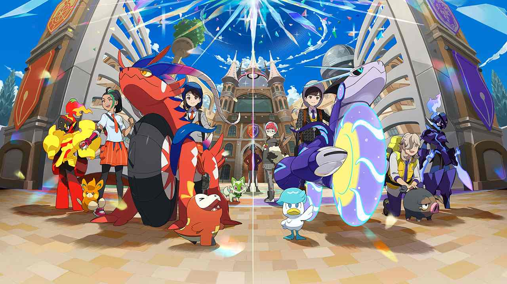

# Scarlet-Recomp

### Pokémon Scarlet, recompiled for Windows.

An independent native PC port of **Pokémon Scarlet 4.0.0**.

**Windows 11** · **Vulkan** · **Native AOT** · **Keyboard & Controller Support**

[Download](https://github.com/xruanzin/Scarlet-Recomp/releases) · [Features](#features) · [Getting Started](#getting-started) · [Known Issues](#known-issues) · [Português](README.pt-BR.md)

---

## About

Scarlet-Recomp brings Pokémon Scarlet to Windows through native recompilation. It runs the game with a Windows/Vulkan runtime instead of running the original Switch system through an emulator.

Built around the player's own copy of **Pokémon Scarlet and update 4.0.0**, with a custom PC launcher, familiar controller layouts, higher frame-rate options, and a growing collection of visual fixes.

## Features

### Native Windows experience

- **Native execution:** Pokémon Scarlet 4.0.0 runs through a recompiled game library and a Vulkan-based Windows runtime.
- **Dedicated launcher:** browse for your game files, choose the update, add optional DLC files, and prepare the installation from one place.
- **Local game preparation:** import your own NSP/XCI files and build the game-specific library on your PC. The original game is not included in this project.
- **Persistent settings:** saved display, input, and launch preferences, with a convenient way to revisit them.

### Frame rate & performance

- **30 FPS:** the original frame-rate option.
- **60 FPS:** a working, tested option for smoother gameplay, with occasional game-specific issues still possible.
- **120 / 240 FPS:** selectable in the launcher, but **experimental**. These modes are not validated for stable gameplay or correct physics and animations.
- **FPS counter and frame pacing:** optional in-game counter and frame presentation settings.
- **Display profiles:** fullscreen or windowed play, adjustable internal resolution, and docked/handheld rendering options.

### Graphics & visual enhancements

- **Resolution scaling:** render above or below the original resolution, with options for sharper output and ultrawide-friendly framing.
- **Upscaling & anti-aliasing:** adjustable image scaling, sharpening, SMAA, and optional AMD FSR rendering paths.
- **Lighting & shadows:** shadow resolution and sharpness, ambient occlusion, indirect lighting, and water-reflection settings.
- **Image quality:** texture filtering, dynamic-resolution controls, and HDR options for compatible displays.
- **Scarlet-specific fixes:** improvements to hair colouring, sky rendering, and other visual issues found during development.

Some advanced rendering options are experimental and may behave differently depending on the GPU or scene.

### Input & controls

- **Xbox, PlayStation, Nintendo, and Steam Deck-style layouts**, plus keyboard and mouse.
- **Custom button mapping:** remap buttons, keyboard keys, mouse input, triggers, and sticks.
- **Native button conventions:** Xbox **A/B** and PlayStation **×/○** follow their familiar confirm/cancel positions when using the matching defaults.
- **Controller prompts:** supported in-game icons adapt to the chosen layout, including face buttons and **Start / Select** equivalents.
- **Mouse camera and controller vibration** with adjustable controls.

### Everyday details

- **English and Brazilian Portuguese** for the PC interface, with automatic language selection based on Windows.
- **In-game language selection** using the languages supplied by the player's own game files.
- **Volume, movie audio, and reverb** controls.
- **Compatibility adjustments** for different systems, plus logs to help track down issues.

## Performance

The port has reached **60 FPS** in the following reported tests:

| GPU | Result |
| :--- | :--- |
| **NVIDIA GeForce RTX 5060** | **60 FPS** — local playtests |
| **NVIDIA GeForce RTX 3050** | **60 FPS** — reported playtests |

Results are not a benchmark or a guarantee of constant frame rates. Performance depends on the CPU, resolution, drivers, and the area being played. The 60 FPS path has been used in gameplay tests, but timing and graphics still need continued validation.

**Higher frame-rate modes (120 and 240 FPS) are experimental.** They may cause animation, physics, or pacing problems, even on fast hardware.

## Getting started

**Requirements:** Windows 11 (64-bit), a Vulkan-capable graphics card with updated drivers, your own Pokémon Scarlet base game and **update 4.0.0**, and keys from your own console setup when needed for importing.

1. Get a Windows package from [Releases](https://github.com/xruanzin/Scarlet-Recomp/releases) when one is published.
2. Extract it to a folder and open **ScarletLauncher.exe**.
3. Select the folder with your own NSP/XCI files, the update, and any optional DLCs. Supply your own keys if requested.
4. Let the launcher prepare the game on your PC, then launch it.

The first setup may take some time while the game is being processed and compiled. The portable package **passed an isolated startup smoke test**, but a complete first-time install on another clean Windows PC has **not yet been verified**. Until that is finished, the project should be treated as a release candidate.

**No game files, NSP/XCI dumps, encryption keys, saves, RomFS, or game-derived compiled DLLs are provided here.**

## Known issues

- **Missing player portrait:** the player's photo may appear black or fail to display on the enrollment form near the beginning of the game. **This is a visual bug that still needs a fix.**
- **Occasional rendering problems:** eyes, eyebrows, certain effects, or textures may not look correct in some scenes.
- **Title-screen button icon:** the original Switch **A** symbol may still appear on the start prompt even after choosing another controller layout.
- **Experimental frame rates:** 120 and 240 FPS are not considered stable. Some timing, camera, or animation issues may also occur in the 60 FPS mode.
- **First-run compatibility:** game preparation and startup on an unrelated Windows installation still need broader testing.

If you find a reproducible issue, you can [report it here](https://github.com/xruanzin/Scarlet-Recomp/issues).

## Development

The current codebase contains the Windows runtime, launcher, game importer, controller mappings, graphics adjustments, and packaging tools.

For local builds and troubleshooting, see the [Windows build guide](docs/BUILD-windows.md), [release requirements](docs/RELEASE-DEPENDENCIES-v1.0.0.md), and the [source code](https://github.com/xruanzin/Scarlet-Recomp).

## Credits

**Scarlet-Recomp** is developed and maintained by **[xruanzin](https://github.com/xruanzin)**.

Based on the work of **[PokeZ-ARecomp](https://github.com/Hexveil404/PokeZ-ARecomp)**, **[LASRecomp](https://github.com/peiikai/LASRecomp)**, and their contributors, with Scarlet-specific changes and additions. Development assistance included ChatGPT.

This is an **unofficial fan project**, not affiliated with Nintendo, Game Freak, or The Pokémon Company. All Pokémon content belongs to its respective owners. See [LICENSE](LICENSE) and third-party license notices.
