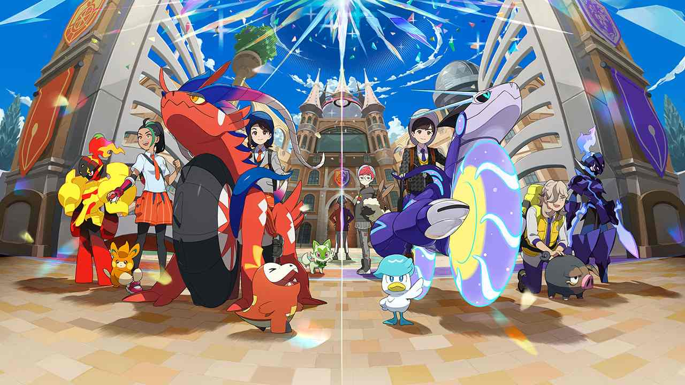

# Scarlet-Recomp

**Pokémon Scarlet no Windows, com controles para PC e novos ajustes de desempenho.**

Port independente para **Pokémon Scarlet 4.0.0** · Windows 11 · Vulkan

[English](README.md) · [Versões](https://github.com/xruanzin/Scarlet-Recomp/releases) · [Novidades](CHANGELOG.md) · [Reportar um problema](https://github.com/xruanzin/Scarlet-Recomp/issues)

---

O **Scarlet-Recomp** é um projeto comunitário que permite executar Pokémon Scarlet de forma nativa no Windows. O jogo é preparado a partir dos arquivos da própria pessoa, sem incluir o conteúdo original no download.

A ideia é simples: deixar a experiência no PC mais confortável, com suporte a diferentes controles, ajustes visuais e novas opções de FPS.

> **Estado atual:** a versão de controles passou no teste do ZIP portátil e já rodou em testes locais. A instalação completa em outro Windows e algumas funções ainda precisam de mais testes. O download público será disponibilizado em **Releases** quando essa etapa estiver concluída.

## O que já tem

- **Controles de PC:** suporte a teclado e mouse, Xbox, PlayStation e Nintendo, com remapeamento pelo menu F1.
- **Ícones dos botões:** escolha o tipo de controle no F1 para exibir os símbolos compatíveis nas imagens já reconhecidas; Start/Select e os botões de ação seguem o padrão selecionado.
- **Menu F1 próprio:** visual claro com detalhes escarlate, opções de vídeo, áudio e controles, em **português ou inglês**.
- **30 e 60 FPS:** modo de 60 FPS disponível para testes, além da opção tradicional de 30 FPS.
- **120 e 240 FPS:** opções presentes no launcher, **altamente experimentais**, sem garantia de estabilidade ou de velocidade correta do jogo.
- **Ajustes gráficos:** resolução, escala de imagem, nitidez, filtros e outras opções para adaptar o visual ao computador.
- **Launcher:** seleção dos arquivos base e atualização 4.0.0 do jogo, DLCs opcionais e chaves próprias para preparar a instalação.
- **Contador de FPS:** opcional, ativado diretamente no F1.

## Testes de desempenho

| Placa de vídeo | Resultado informado |
| --- | --- |
| **GeForce RTX 5060** | **60 FPS** em testes locais |
| **GeForce RTX 3050** | **60 FPS** em testes informados para o projeto |

São resultados de testes, não requisitos mínimos ou garantia de desempenho. CPU, resolução, drivers e a cena do jogo também influenciam. O modo de 60 FPS ainda pode apresentar comportamentos inesperados em alguns momentos.

## Fotos

A imagem acima é a **arte do launcher**. Estamos organizando uma galeria com imagens reais da jogabilidade, do menu F1 e dos controles; elas serão adicionadas aqui conforme forem registradas.

[Ver a galeria e como enviar fotos](docs/showcase/README.md)

## Problemas conhecidos

O projeto ainda está em desenvolvimento. Alguns problemas visuais podem aparecer:

- **Retrato do jogador no início:** a foto do personagem pode ficar preta ou não aparecer na ficha de matrícula. **É um bug visual conhecido, ainda a ser corrigido**, não uma opção desativada.
- **Rostos e efeitos:** olhos, sobrancelhas e alguns efeitos gráficos podem apresentar falhas em cenas específicas.
- **Símbolo na tela inicial:** a frase *“PRESSIONE A PARA COMEÇAR”* pode continuar mostrando o ícone original do Switch, mesmo com outro controle selecionado no F1.
- **FPS acima de 60:** os modos 120 e 240 FPS são experimentais e podem afetar animações, física e velocidade do jogo.

## Como começar

Quando um pacote público estiver disponível, ele ficará na página de [Releases](https://github.com/xruanzin/Scarlet-Recomp/releases). É necessário ter **Windows 11 (64 bits)**, placa compatível com Vulkan, os **arquivos próprios** do jogo base e da atualização **4.0.0** e as chaves da sua instalação quando solicitadas.

O launcher reúne as ferramentas para preparar o jogo localmente. O primeiro processo pode demorar; ainda estamos validando todo o fluxo fora do computador de desenvolvimento.

O repositório **não disponibiliza NSP/XCI, chaves, saves, arquivos do jogo ou a DLL compilada a partir dele**.

## Créditos

Projeto desenvolvido por **[xruanzin](https://github.com/xruanzin)**, com base no trabalho de [PokeZ-ARecomp](https://github.com/Hexveil404/PokeZ-ARecomp) e [LASRecomp](https://github.com/peiikai/LASRecomp) e seus colaboradores. O F1 foi adaptado a partir do menu original desses projetos. Desenvolvimento com apoio de ferramentas de IA.

Projeto não oficial, sem vínculo com Nintendo, Game Freak ou The Pokémon Company. Consulte a [licença](LICENSE) e os avisos das dependências.
